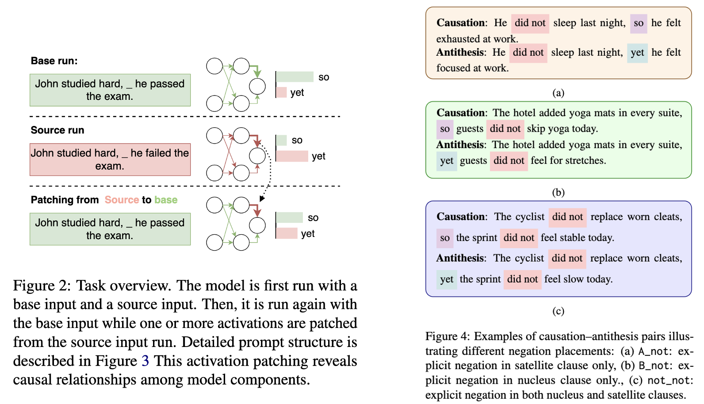

# "So" It Happens, "Yet" We Wonder: Investigating Causation and Antithesis Relations in Language Models

[Abhidip Bhattacharyya](https://abhidipbhattacharyya.github.io/) · [Shira Wein](https://shirawein.github.io/)

📄 [Paper](#) · 🤗 [Dataset](https://github.com/abhidipbhattacharyya/So_It_Happens_Yet_We_Wonder/tree/main/Discursive-Circuits/data) · 💻 [Code](#)



---

## Overview

This work investigates how Transformer-based language models encode two frequent yet structurally opposing discourse relations: **causation** and **antithesis**. We study these relations from two complementary perspectives:

1. **Semantic**: the contributions of discourse constructions, negation, and lexical content.
2. **Circuit-level**: the underlying transformer mechanisms responsible for encoding these relations.

---

## Citation

If you use this work, please cite:

```bibtex
@inproceedings{bhattacharyya-wein-2026,
    title = "``So'' It Happens, ``Yet'' We Wonder: Investigating Causation and Antithesis Relations in Language Models",
    author = "Bhattacharyya, Abhidip and Wein, Shira",
    year = "2026"
}
```

---

## Acknowledgements

This work builds on two excellent prior works:

```bibtex
@inproceedings{boguraev-etal-2025-causal,
    title = "Causal Interventions Reveal Shared Structure Across {E}nglish Filler{--}Gap Constructions",
    author = "Boguraev, Sasha and Potts, Christopher and Mahowald, Kyle",
    booktitle = "Proceedings of the 2025 Conference on Empirical Methods in Natural Language Processing",
    month = nov,
    year = "2025",
    address = "Suzhou, China",
    publisher = "Association for Computational Linguistics",
    url = "https://aclanthology.org/2025.emnlp-main.1271/",
    doi = "10.18653/v1/2025.emnlp-main.1271",
    pages = "25032--25053"
}

@inproceedings{miao-kan-2025-discursive,
    title = "Discursive Circuits: How Do Language Models Understand Discourse Relations?",
    author = "Miao, Yisong and Kan, Min-Yen",
    booktitle = "Proceedings of the 2025 Conference on Empirical Methods in Natural Language Processing",
    month = nov,
    year = "2025",
    address = "Suzhou, China",
    publisher = "Association for Computational Linguistics",
    url = "https://aclanthology.org/2025.emnlp-main.1657/",
    pages = "32558--32577"
}
```

---

## License

This project is licensed under the [MIT License](LICENSE).
